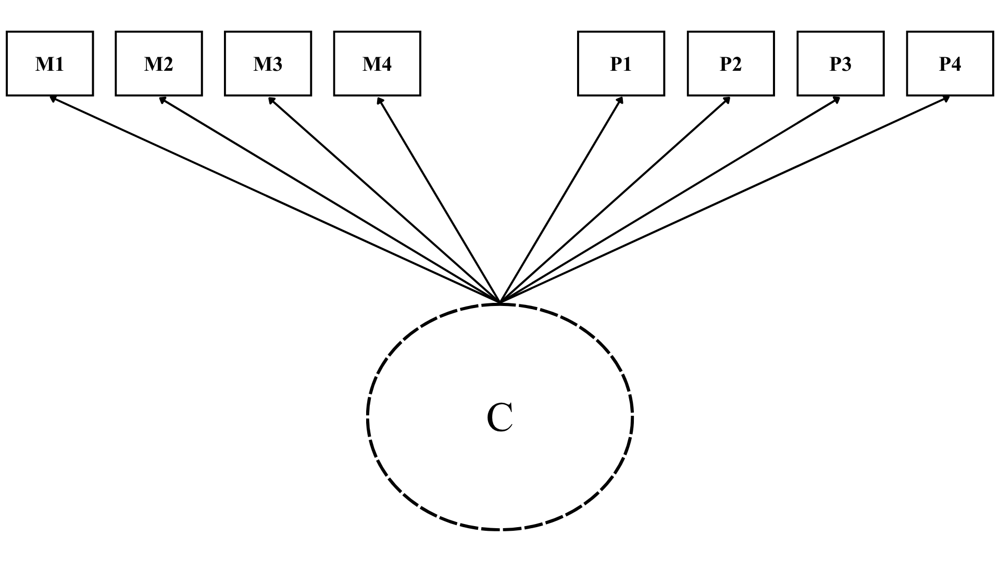

---
title: "Data, Variables and Methods"
---

## Data

The data come from the EDUMERCO dataset, a survey conducted as part of the EDUMER-funded project that focused on beliefs and attitudes toward meritocracy and inequality. The survey was conducted in 2025 via Computer-Assisted Web Interviewing (CAWI) among adults aged 18 to 75 in the Santiago Metropolitan Region of Chile. The sampling design was a quota-based non-probability sample, with quotas for age, sex, educational level, and socioeconomic status that approximated the population parameters. The total sample consisted of 3,470 respondents.

## Variables

The dependent variable of this study is the preference for market justice in education. This construct is measured using the following statement: “It is just that high-income people have a better education for their children than people with lower incomes” (“Es justo que las personas de altos ingresos tengan una mejor educación para sus hijos que las personas con ingresos más bajos” in Spanish). The responses cathegories are based on a Likert scale from (1) “strongly disagree” to (5) “strongly agree”. 

The main independent variable in this study is meritocratic beliefs. To this end, two dimensions are distinguished: (1) meritocratic perceptions and preferences, and (2) perceptions and acceptance of privilege. Meritocratic and privilege-based perceptions and preferences were measured using the same items proposed in the original scale [@castillo_multidimensional_2023]. The items are as follows:

-  Meritocratic perceptions: the extent to which effort and ability are rewarded in Chile,
-  Meritocratic preferences: agreement with that those who work harder or are more talented should be better rewarded,
-  Privilege perceptions: the extent to which success is perceived as linked to connections and family wealth,
-  Privilege acceptance: agreement that it is acceptable for individuals with better connections or wealthy parents to achieve
greater success.

Each item is rated on a four-point Likert scale ranging from “strongly disagree” (1) to “strongly agree” (4), higher
scores indicate stronger endorsement of the corresponding perception or preference.

In addition, other independent variables considered are educational level and political identification. Educational level is measured using the question: “What is the most recent course or level of study you completed?” (“¿Cuál es el último curso o nivel de estudios que completó?” in Spanish). The response categories range from 1 to 9, where higher values indicate a higher level of education among respondents. Political identification, meanwhile, is measured along a left-right axis using a 6-category scale, where 1 indicates right, 5 indicates left, and 6 indicates independent.

```{r}
#| echo: false

if (!require("pacman")) install.packages("pacman")

pacman::p_load(tidyverse,
               sjmisc, 
               here,
               sjlabelled,
               naniar,
               knitr,
               kableExtra)


options(scipen=999)
rm(list = ls())

# 2. Data -----------------------------------------------------------------

here::i_am("paper/03-metodologia.qmd")
load(here::here("paper", "input/data/proc/db_proc.RData"))

# 3. Variables ------------------------------------------------------------

# db_proc.RData is already processed (see procesamiento/proc-data.r)

vars_m <- c("perc_effort",
            "perc_talent",
            "perc_rich_parents",
            "perc_contact",
            "pref_effort",
            "pref_talent",
            "pref_rich_parents",
            "pref_contact")

# descriptive table: dependent and independent variables ----

vars_indep <- c(vars_m, "educ", "pol", "income")

var_labels <- c(
  just_educ         = "Education market justice preferences",
  perc_effort       = "Effort perception",
  perc_talent       = "Talent perception",
  perc_rich_parents = "Rich parents perception",
  perc_contact      = "Contact perception",
  pref_effort       = "Effort preference",
  pref_talent       = "Talent preference",
  pref_rich_parents = "Rich parents preference",
  pref_contact      = "Contact preference",
  educ              = "Educational level",
  pol               = "Political identification",
  income            = "Income"
)

desc_dep <- db %>%
  dplyr::select(just_educ) %>%
  mutate(across(everything(), as.character)) %>%
  pivot_longer(everything(), names_to = "variable", values_to = "category") %>%
  filter(!is.na(category)) %>%
  count(variable, category, name = "n") %>%
  mutate(group = "Dependent variable")

desc_indep <- db %>%
  dplyr::select(all_of(vars_indep)) %>%
  mutate(across(everything(), as.character)) %>%
  pivot_longer(everything(), names_to = "variable", values_to = "category") %>%
  filter(!is.na(category)) %>%
  count(variable, category, name = "n") %>%
  mutate(group = "Independent variables")

desc_tbl <- bind_rows(desc_dep, desc_indep) %>%
  mutate(variable = factor(variable,
                           levels = c("just_educ", vars_indep),
                           labels = var_labels[c("just_educ", vars_indep)])) %>%
  arrange(group, variable) %>%
  dplyr::select(group, variable, category, n)

group_index <- desc_tbl %>%
  count(group) %>%
  tibble::deframe()

out_format <- if (knitr::is_latex_output()) "latex" else "html"

tab_desc <- desc_tbl %>%
  dplyr::select(-group) %>%
  rename(Variable = variable, Category = category, `Valid N` = n) %>%
  kbl(format = out_format,
      align = "llr",
      booktabs = TRUE) %>%
  kable_styling(bootstrap_options = c("striped", "hover", "condensed", "responsive"),
                latex_options = c("striped", "hold_position"),
                full_width = FALSE,
                font_size = 13) %>%
  collapse_rows(columns = 1, valign = "top") %>%
  pack_rows(index = group_index)

```

```{r}
#| label: tbl-desc
#| tbl-cap: Descriptive statistics of variables
#| tbl-cap-location: top
#| echo: false

tab_desc
```

Based on previous research [@castillo_perceptions_2025], the statistical models include sociodemographic controls to account for potential compositional effects in the population. The control variables are age (en años) and sex (0 = male; 1 = women).

## Analytical strategy

First, a latent class analysis (LCA) is conducted to identify the latent classes (C) that represent meritocratic belief patterns. Second, once the optimal model has been determined, each individual is assigned the latent class to which they are most likely to belong. Third, a multinomial logistic regression is performed to examine the relationship between membership in latent classes and a preference for market justice in education, while also considering the effects of education and political identification on the dependent variable. 

### Latent class analysis

LCA is conducted using the poLCA package in R [@linzer_polca_2011], with meritocratic and privilege-based indicators as dichotomized variables. The model is estimated using the Expectation-Maximization (EM) and Newton-Raphson algorithms, which iteratively estimate the model's parameters until convergence. The optimal number of latent classes is determined based on a combination of statistical criteria, including the Akaike Information Criterion (AIC), Bayesian Information Criterion (BIC), and entropy. Lower AIC and BIC values indicate better model fit, while higher entropy values indicate better classification accuracy.

```{r}
#| label: fig-h1
#| fig-cap: Conceptual map for latent class analysis (LCA). "C" represents latent class memberships. "M1-M4" represents four meritocratic intems used as LCA indicators, and "P1-P4" represents four privileged items used as LCA indicators.
#| fig-cap-location: bottom
#| echo: false


```

### Ordinal logistic regression

After determining the optimal number of latent classes, individuals are assigned to their most likely latent class memberships based on their posterior probabilities. An ordinal logistic regression is then conducted to examine the relationship between latent class memberships and the preference for market justice in education. The ordinal logistic regression model is also estimated in R, with the preference for market justice in education as the dependent variable and latent class memberships, educational level, and political identification as independent variables.

### Robustness analysis

To ensure the robustness of the research findings, I decided to replicate the procedure with a student population from the same country. This was possible because I had access to a dataset generated by the same project from the main database. As a result, the same variables were available to conduct a complete replication of the study. The analyses in this section will be performed using the same software and the same code libraries.
