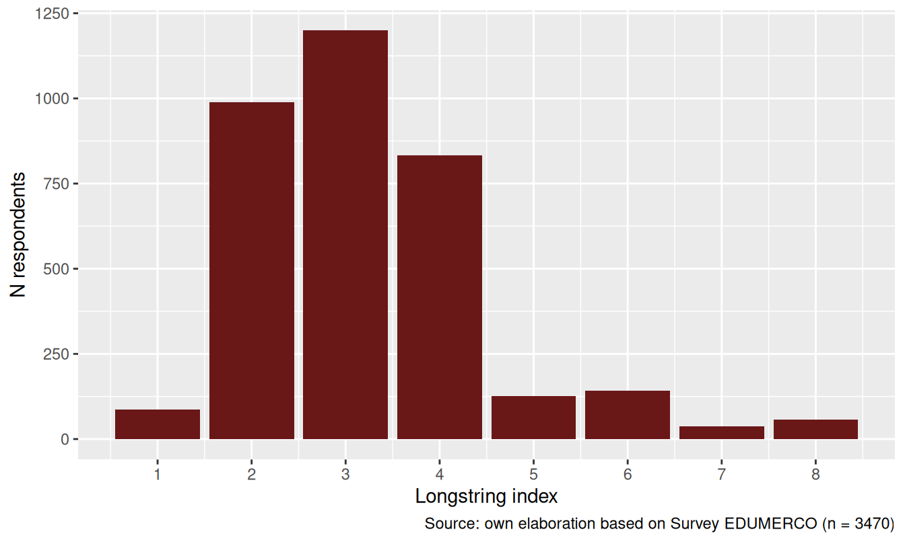
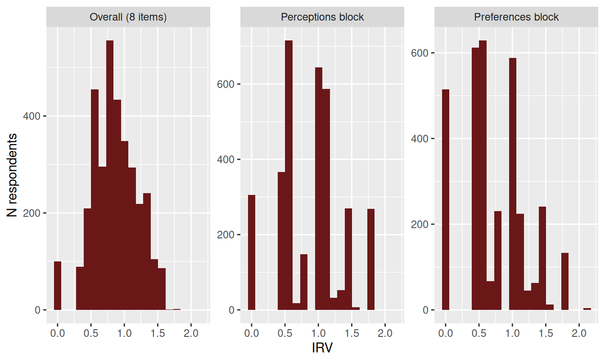
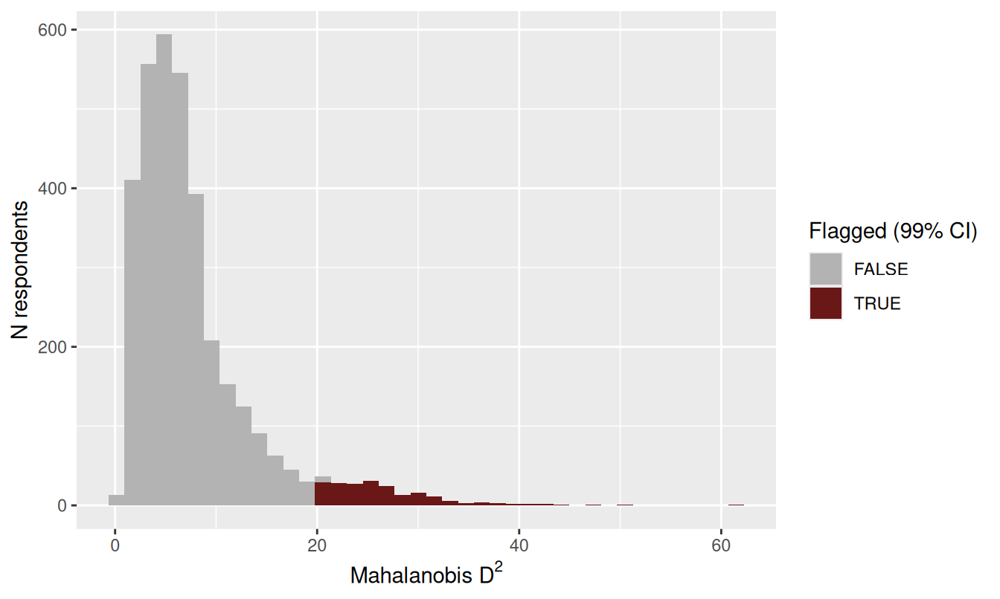

---
title: "Appendices"
---

This section contains the initial analyses related to latent class estimation. The analysis is divided into three main parts: first, a process is carried out to identify careless respondents in order to verify the quality of the data we are working with. Based on these analyses, cases that introduce noise into the sample are removed, and latent classes are then estimated using dichotomized items. Afterward, another latent class analysis is conducted without dichotomizing the variables, with the aim of determining whether there are substantial changes in the composition of each group. Finally, preliminary conclusions from the analyses are presented.

```{r}
#| label: packages
#| echo: false

if (! require("pacman")) install.packages("pacman")

pacman::p_load(tidyverse,
               sjmisc,
               here,
               lavaan,
               psych,
               corrplot,
               ggdist,
               sjlabelled,
               patchwork,
               RColorBrewer,
               poLCA,
               reshape,
               summarytools,
               careless)

options(scipen=999)
rm(list = ls())
```

## Data

```{r}
#| label: data
#| echo: true

here::i_am("paper/04-resultados.qmd")
load(here::here("paper", "input/data/proc/db_proc.RData"))
```

```{r}
#| echo: false

vars_m <- c("perc_effort",
            "perc_talent",
            "perc_rich_parents",
            "perc_contact",
            "pref_effort",
            "pref_talent",
            "pref_rich_parents",
            "pref_contact")
```

```{r}
#| label: proc
#| echo: false

db <- db %>% 
  mutate(
    income_4 = case_when(
      income %in% c(
        "Menos de $280.000 mensuales liquidos",
        "De $280.001 a $380.000 mensuales liquidos",
        "De $380.001 a $470.000 mensuales liquidos"
      ) ~ "Low",
      
      income %in% c(
        "De $470.001 a $610.000 mensuales liquidos",
        "De $610.001 a $730.000 mensuales liquidos"
      ) ~ "Middle-low",
      
      income %in% c(
        "De $730.001 a $890.000 mensuales liquidos",
        "De $890.001 a $1.100.000 mensuales liquidos"
      ) ~ "Middle-high",
      
      income %in% c(
        "De $1.100.001 a $2.700.000 mensuales liquidos",
        "De $2.700.001 a $4.100.000 mensuales liquidos",
        "Mas de $4.100.001 mensuales liquidos"
      ) ~ "High",
      
      TRUE ~ NA_character_
    ),
    income_4 = factor(income_4, levels = c("Low", "Middle-low", "Middle-high", "High"))
  )


db$income_4 <- sjlabelled::set_label(db$income_4, "Income")

db$age <- sjlabelled::set_label(db$age, "Age")

db$sex <- if_else(db$sex == 1, "Male", "Female")

db$sex <- factor(db$sex, levels = c("Male", "Female"))

db$sex <- sjlabelled::set_label(db$sex, "Sex")

db$educ <- sjlabelled::set_label(db$educ, "Educational level")


db$pol <- sjlabelled::set_label(db$pol, "Political identification")


```

## Analysis


### Patterns responses {#sec-patterns-responses}

Before estimating the latent class models, I screened the eight meritocratic scale items for careless or insufficient-effort responding (IER), following the diagnostic framework proposed by @curran_methods_2016. I used the `careless` package to compute three indicator families, each capturing a different signature of low-quality responding: (a) the **longstring** index, the longest run of identical consecutive responses; (b) the **intra-individual response variability** (IRV), the within-person standard deviation across items and (c) the **Mahalanobis distance** (D²) of each response vector relative to the sample centroid, which flags multivariate outliers. Each index was estimated separately, as they are sensitive to different response patterns (straightlining, random responding, and inconsistency, respectively) and are not expected to fully overlap.

```{r}
#| label: careless-prep

vars_careless <- vars_m

db_careless <- db %>%
  dplyr::select(id, all_of(vars_careless)) %>%
  mutate(across(-id, as.numeric))

x_careless <- db_careless %>% dplyr::select(-id)
```

#### Longstring index

```{r}
#| label: fig-longstring
#| out-width: '70%'
#| fig-asp: 0.6
#| fig-cap: "Longstring index: longest run of identical consecutive responses (max = 8 items)"
#| fig-cap-location: top

ls_res <- careless::longstring(x_careless, avg = TRUE)

db_careless <- db_careless %>%
  mutate(longstring = ls_res$longstr,
         avgstring  = ls_res$avgstr)

# ggplot(db_careless, aes(x = longstring)) +
#   geom_bar(fill = "#6a1718") +
#   scale_x_continuous(breaks = 1:8) +
#   labs(x = "Longstring index", y = "N respondents",
#        caption = paste0("Source: own elaboration based on Survey EDUMERCO (n = ", nrow(db_careless), ")"))


```


@fig-longstring shows, as a bar chart, how many respondents reached each possible value of the index, from 1 up to 8 (the maximum, since the battery has eight items). Most respondents cluster at the low end (1 to 3 identical answers in a row): this is the expected pattern, since it means their answer changed as they moved from one item to the next, consistent with actually reading and evaluating each statement. The right side of the distribution is where straightlining shows up. It is also worth noting that, because the eight items are organized in two four-item blocks (perceptions, then preferences), a run of six or more identical responses necessarily crosses from one block into the other — so it cannot be a coincidence tied to one particular question, but reflects the same answer being carried across two conceptually different sets of items. With an eight-item battery the longstring index ranges from 1 to 8. `r sum(db_careless$longstring >= 6)` respondents (`r round(100*mean(db_careless$longstring >= 6),1)`%) gave the same response to at least six of the eight items in a row, and `r sum(db_careless$longstring == 8)` (`r round(100*mean(db_careless$longstring == 8),1)`%) answered identically to all eight, consistent with straightlining.

#### Intra-individual response variability (IRV)

```{r}
#| label: fig-irv
#| out-width: '80%'
#| fig-asp: 0.6
#| fig-cap: "Intra-individual response variability (IRV), overall and by item block"
#| fig-cap-location: top

irv_res <- careless::irv(x_careless, na.rm = TRUE, split = TRUE, num.split = 2)

db_careless <- db_careless %>%
  mutate(irv_total = irv_res$irvTotal,
         irv_perc  = irv_res$irv1,
         irv_pref  = irv_res$irv2)

# db_careless %>%
#   dplyr::select(id, `Overall (8 items)` = irv_total,
#                 `Perceptions block` = irv_perc,
#                 `Preferences block` = irv_pref) %>%
#   pivot_longer(-id, names_to = "block", values_to = "irv") %>%
#   ggplot(aes(x = irv)) +
#   geom_histogram(bins = 20, fill = "#6a1718") +
#   facet_wrap(~block, scales = "free_y") +
#   labs(x = "IRV", y = "N respondents")


```

The IRV summarizes, for each respondent, how much their own answers moved across the eight items: someone who marks the same option (or nearly so) throughout the battery gets a low IRV, while someone who uses different points of the scale gets a higher one. In the histograms above, respondents piling up near zero (left side) are those whose answers were essentially flat — the pattern expected from careless or straightlined responding — while respondents further to the right made more use of the response scale, as most people do. Because the items are ordered in two conceptual blocks (perceptions, then preferences), splitting the IRV in two (`num.split = 2`) shows this same left-to-right pattern separately for each block, which also reveals whether flat responding is concentrated in only one part of the questionnaire rather than spread across the whole battery. Following @dunn_intraindividual_2018, we flag *low* IRV as a marker of straightlining: `r sum(db_careless$irv_total <= quantile(db_careless$irv_total, .05, na.rm = TRUE), na.rm = TRUE)` respondents (`r round(100*mean(db_careless$irv_total <= quantile(db_careless$irv_total, .05, na.rm = TRUE), na.rm = TRUE),1)`%) fall at or below the 5th percentile of the overall IRV distribution — i.e., the flattest 5% of the sample.

#### Mahalanobis distance

```{r}
#| label: fig-mahad
#| out-width: '70%'
#| fig-asp: 0.6
#| fig-cap: "Mahalanobis D² of item-response vectors, flagged at the 99% confidence level"
#| fig-cap-location: top

mahad_res <- careless::mahad(x_careless, plot = FALSE, flag = TRUE, confidence = 0.99, na.rm = TRUE)

db_careless <- db_careless %>%
  mutate(mahad_d = mahad_res$d_sq,
         mahad_flag = mahad_res$flagged)

# ggplot(db_careless, aes(x = mahad_d, fill = mahad_flag)) +
#   geom_histogram(bins = 40) +
#   scale_fill_manual(values = c("FALSE" = "grey70", "TRUE" = "#6a1718"), name = "Flagged (99% CI)") +
#   labs(x = expression(paste("Mahalanobis ", D^2)), y = "N respondents")


```

The Mahalanobis distance takes a different approach from the previous two indices: instead of looking at a respondent's answers on their own, it compares each respondent's whole pattern of answers against the pattern that is typical for the sample as a whole — taking into account how the eight items normally relate to one another (e.g., that seeing wealthy parents as an advantage tends to go together with seeing personal contacts as one). A person can therefore give variable, non-repetitive answers and still get a high Mahalanobis distance if the *combination* of their answers is unusual given how the items normally move together in the rest of the sample; this is why the index is described as multivariate rather than item-by-item. In the histogram, respondents piled up on the left have D² values close to zero, meaning their overall response pattern is unremarkable, while the tail stretching to the right holds respondents whose combined pattern departs the most from what is typical. Bars are colored to mark which of these are flagged as outliers under a 99% confidence threshold (grey = within the expected range, red = flagged) — a deliberately conservative cutoff, so only the most extreme patterns are marked. At this conservative 99% confidence level, `r sum(db_careless$mahad_flag, na.rm = TRUE)` respondents (`r round(100*mean(db_careless$mahad_flag, na.rm = TRUE),1)`%) are flagged as multivariate outliers relative to the response distribution of the other eight items.

#### Combined diagnosis

```{r}
#| label: tbl-careless-flags
#| tbl-cap: "Overlap between careless-responding flags (longstring ≥ 6, IRV ≤ p5, Mahalanobis 99% CI)"
#| tbl-cap-location: top

careless_flags <- db_careless %>%
  mutate(
    flag_longstring = longstring >= 6,
    flag_irv        = irv_total <= quantile(irv_total, .05, na.rm = TRUE),
    flag_mahad      = mahad_flag,
    n_flags         = rowSums(across(c(flag_longstring, flag_irv, flag_mahad)), na.rm = TRUE),
    careless_2of3   = n_flags >= 2
  )

careless_flags %>%
  count(n_flags) %>%
  mutate(pct = round(100 * n / sum(n), 1)) %>%
  kableExtra::kable(format = "html", align = "c",
                    col.names = c("N indices flagging", "N respondents", "%"),
                    caption = NULL) %>%
  kableExtra::kable_styling(full_width = TRUE,
                            bootstrap_options = c("striped", "bordered", "condensed"))
```

```{r}
#| label: careless-merge

db <- db %>%
  left_join(
    careless_flags %>%
      dplyr::select(id, longstring, irv_total, mahad_d,
                    flag_longstring, flag_irv, flag_mahad, n_flags, careless_2of3),
    by = "id"
  )
```

@tbl-careless-flags shows that the three usable indices agree only partially: `r sum(careless_flags$n_flags == 0, na.rm = TRUE)` respondents (`r round(100*mean(careless_flags$n_flags == 0, na.rm = TRUE),1)`%) are not flagged by any index, `r sum(careless_flags$n_flags == 1, na.rm = TRUE)` (`r round(100*mean(careless_flags$n_flags == 1, na.rm = TRUE),1)`%) are flagged by exactly one, `r sum(careless_flags$n_flags == 2, na.rm = TRUE)` (`r round(100*mean(careless_flags$n_flags == 2, na.rm = TRUE),1)`%) by exactly two, and only `r sum(careless_flags$n_flags == 3, na.rm = TRUE)` (`r round(100*mean(careless_flags$n_flags == 3, na.rm = TRUE),1)`%) by all three. Summing the last two rows of the table, `r sum(careless_flags$n_flags >= 2, na.rm = TRUE)` respondents (`r round(100*mean(careless_flags$n_flags >= 2, na.rm = TRUE),1)`%) are flagged by two or more indices — the threshold used below to define likely careless respondents. This limited overlap is expected — longstring targets straightlining, low IRV targets low variability more generally, and Mahalanobis D² targets multivariate inconsistency — and is itself evidence against relying on any single index [@curran_methods_2016].

Considering the results of patterns responses analysis, I decided to remove the cases that could be considered careless respondents and, after doing so, re-estimate the latent classes.


### Latent class analysis with dichotomized items {#sec-lca-dichotomized}

```{r}
#| include: false
# --- helpers -------------------------------------------------------------

get_K <- function(fit) {
  # robust: number of classes = columns of posterior
  if (!is.null(fit$posterior)) return(as.integer(ncol(fit$posterior)))
  # fallback: rows of probs for first item
  if (!is.null(fit$probs) && length(fit$probs) > 0) return(as.integer(nrow(fit$probs[[1]])))
  stop("Cannot determine K from poLCA object (no posterior/probs).")
}

get_npar <- function(fit) {
  if (!is.null(fit$npar)) return(as.numeric(fit$npar))
  # fallback if npar missing (rare): compute from probs + class shares
  K <- get_K(fit)
  Rj <- vapply(fit$probs, function(m) if (is.matrix(m)) ncol(m) else NA_integer_, integer(1))
  if (anyNA(Rj)) stop("Cannot compute npar: missing category counts in fit$probs.")
  as.numeric(sum(K * (Rj - 1)) + (K - 1))
}

get_n_patterns_obs <- function(fit) {
  # poLCA usually stores predicted cell counts for observed patterns as a vector
  if (!is.null(fit$predcell)) return(as.integer(length(fit$predcell)))
  # fallback: sometimes observed pattern table exists
  if (!is.null(fit$observed) && is.matrix(fit$observed)) return(as.integer(nrow(fit$observed)))
  NA_integer_
}

n_patterns_from_data <- function(data_indicators) {
  # data_indicators = db_lca with only indicators (your a1..a8), already NA-omitted
  as.integer(nrow(dplyr::distinct(data_indicators)))
}


entropy_stats <- function(fit) {
  P <- fit$posterior
  P <- pmax(P, 1e-12)
  N <- nrow(P); K <- ncol(P)
  
  # relative entropy (0..1): 1 = best separation
  rel_entropy <- 1 - (-sum(P * log(P)) / (N * log(K)))
  
  class_hat <- max.col(P)
  max_p <- apply(P, 1, max)
  
  avg_diag <- vapply(1:K, function(k) {
    idx <- which(class_hat == k)
    if (length(idx) == 0) NA_real_ else mean(P[idx, k])
  }, numeric(1))
  
  tibble(
    entropy = rel_entropy,
    mean_max_p = mean(max_p),
    p10_max_p = unname(quantile(max_p, 0.10)),
    avg_diag_min = suppressWarnings(min(avg_diag, na.rm = TRUE)),
    avg_diag_mean = mean(avg_diag, na.rm = TRUE)
  )
}

min_class_share <- function(fit) {
  Ppost <- fit$posterior
  N <- nrow(Ppost); K <- ncol(Ppost)
  class_hat <- max.col(Ppost)
  
  tibble(
    min_class_prior = min(fit$P),
    min_class_map   = min(tabulate(class_hat, nbins = K)) / N
  )
}

```


```{r}
#| include: false
# 3.3 LCA: dichotomized items ----

# Countermeasure for careless responding: drop respondents flagged by >= 2 of
# the 3 usable careless indices (longstring, IRV, Mahalanobis; see "Patterns
# responses") before building the LCA indicators.
df <- db %>%
  dplyr::filter(!careless_2of3) %>%
  dplyr::select(id, ends_with("_d")) %>%
  na.omit()

a1 <- df$perc_effort_d
a2 <- df$perc_talent_d
a3 <- df$perc_rich_parents_d
a4 <- df$perc_contact_d
a5 <- df$pref_effort_d
a6 <- df$pref_talent_d 
a7 <- df$pref_rich_parents_d
a8 <- df$pref_contact_d
id <- df$id

db_lca <- data.frame(id, a1, a2, a3, a4, a5, a6, a7, a8) %>% as_tibble()

db_lca <- db_lca %>% 
  mutate_at(.vars = 2:9, ~as.factor(.))

f <-cbind(a1, a2, a3, a4, a5, a6, a7, a8)~1

fit_lca <- function(K, data, formula, nrep = 50, maxiter = 3000, seed = 123) {
  set.seed(seed)
  poLCA(formula, data = data, nclass = K,
        nrep = nrep, maxiter = maxiter,
        verbose = FALSE, graphs = FALSE)
}

Ks <- 1:5
#fits <- lapply(Ks, fit_lca, data = db_lca, formula = f, nrep = 30)
#save(fits, file = here("paper", "output/fits_models_lca.RData"))

load(here::here("paper", "output/fits_models_lca.RData"))

fit_tbl <- data.frame(
  K    = Ks,
  logLik = sapply(fits, `[[`, "llik"),
  AIC  = sapply(fits, `[[`, "aic"),
  BIC  = sapply(fits, `[[`, "bic"),
  Gsq  = sapply(fits, `[[`, "Gsq"),
  Chisq = sapply(fits, `[[`, "Chisq")
)

fit_tbl
```

We estimated latent class models with one to five classes on the sample screened for careless responding (respondents flagged by two or more of the three usable indices in @sec-patterns-responses were excluded beforehand). Model fit improved monotonically as the number of classes increased, as indicated by decreasing AIC and BIC values and statistically significant likelihood-ratio tests at each step (@tbl-fit).

```{r}
#| label: tbl-fit
#| tbl-cap: "Fit comparision of latent class models"
#| tbl-cap-location: top

# ---- build table (no list-cols) -----------------------------------------

N_used <- nrow(db_lca)

m_patterns <- n_patterns_from_data(db_lca)  # scalar

# Robust extractors (avoid list-columns)
get_K <- function(fit) as.integer(ncol(fit$posterior))  # classes = cols of posterior
get_ll  <- function(fit) as.numeric(fit$llik)
get_aic <- function(fit) as.numeric(fit$aic)
get_bic <- function(fit) as.numeric(fit$bic)
get_npar <- function(fit) {
  if (!is.null(fit$npar)) return(as.numeric(fit$npar))
  # fallback: compute from probs
  K <- get_K(fit)
  Rj <- vapply(fit$probs, function(m) ncol(m), integer(1))
  as.numeric(sum(K * (Rj - 1)) + (K - 1))
}

# Table of fit indices
fit_tbl <- tibble(
  K     = map_int(fits, get_K),
  N     = nrow(db_lca),
  logLik= map_dbl(fits, get_ll),
  npar  = map_dbl(fits, get_npar),
  AIC   = map_dbl(fits, get_aic),
  BIC   = map_dbl(fits, get_bic)
) %>%
  arrange(K) %>%
  mutate(
    # Differences relative to preceding (K-1) model
    dAIC = AIC - lag(AIC),
    dBIC = BIC - lag(BIC),
    
    # Likelihood-ratio test (K vs K-1)
    # Test statistic: 2*(LL_K - LL_{K-1}) ~ Chi-square with df = npar_K - npar_{K-1}
    # Note: in LCA, models are not strictly nested in the regular sense;
    # this LRT is widely used as a heuristic, but interpret with caution.
    LRT = 2 * (logLik - lag(logLik)),
    df_LRT = npar - lag(npar),
    p_LRT = ifelse(!is.na(LRT) & df_LRT > 0, pchisq(LRT, df = df_LRT, lower.tail = FALSE), NA_real_)
  )


fit_tbl_report <- fit_tbl %>%
  transmute(
    K, N,
    logLik = round(logLik, 1),
    npar = npar,
    AIC = round(AIC, 1),
    dAIC = round(dAIC, 1),
    BIC = round(BIC, 1),
    dBIC = round(dBIC, 1),
    LRT = round(LRT, 1),
    df_LRT = df_LRT,
    p_LRT = signif(p_LRT, 3)
  )

fit_tbl_report %>% 
 kableExtra::kable(format = "html",
                    align = "c",
                    booktabs = T,
                    escape = F,
                    caption = NULL) %>%
  kableExtra::kable_styling(full_width = T,
                            latex_options = "hold_position",
                            bootstrap_options=c("striped", "bordered", "condensed"),
                            font_size = 23) %>%
  kableExtra::column_spec(c(1,8), width = "3.5cm") %>% 
  kableExtra::column_spec(2:7, width = "4cm") %>% 
  kableExtra::column_spec(4, width = "5cm")

```

```{r}
#| label: fig-visaic
#| out-width: '80%'
#| fig-asp: 0.8
#| fig-cap: "Visual: AIC/BIC by K (lower is better)"
#| fig-cap-location: top


# Visual: AIC/BIC by K (lower is better)
fit_long <- fit_tbl %>%
  dplyr::select(K, AIC, BIC) %>%
  pivot_longer(-K, names_to = "criterion", values_to = "value")

ggplot(fit_long, aes(x = K, y = value, group = criterion)) +
  geom_line() +
  geom_point() +
  facet_wrap(~criterion, scales = "free_y") +
  labs(x = "Number of classes (K)", y = "Value") 


```

```{r}
#| label: fig-dfvisaic
#| out-width: '80%'
#| fig-asp: 0.8
#| fig-cap: "ΔAIC and ΔBIC (negative = improvement over K-1)"
#| fig-cap-location: top

# Visual: ΔAIC and ΔBIC (negative = improvement over K-1)
delta_long <- fit_tbl %>%
  dplyr::select(K, dAIC, dBIC) %>%
  pivot_longer(-K, names_to = "delta", values_to = "value")

ggplot(delta_long, aes(x = K, y = value, group = delta)) +
  geom_hline(yintercept = 0) +
  geom_line() +
  geom_point() +
  facet_wrap(~delta, scales = "free_y") +
  labs(x = "K", y = "Change vs K-1 (negative = better)") 
```


We can see in @tbl-fit that the incremental improvement in fit became substantially smaller after the four-class solution. Whereas the transition from one to four classes yielded large reductions in AIC and BIC, the five-class model provided only a modest additional improvement (AIC = 19,419.9; BIC = 19,678.4) relative to the four-class solution (AIC = 19,560.0; BIC = 19,765.6). Thus, although the five-class model fit the data slightly better in statistical terms, the gain was comparatively limited.

I therefore retained the four-class solution as the final model. This choice was guided by both statistical and substantive criteria: the four-class model achieved a strong balance between goodness of fit, parsimony, and interpretability, whereas the five-class solution did not yield enough additional differentiation to justify the increase in complexity.

### Four latent class model

```{r}
#| label: fig-prob
#| out-width: '80%'
#| fig-asp: 0.8
#| fig-cap: "P(endorsement | class) for each item"
#| fig-cap-location: top

fit4 <- fits[[4]]

# 2) Extract conditional probabilities per item and class
# fit4$probs is a list: each element is K x Rj matrix.
# For dichotomous items: K x 2 (categories = colnames or "1","2")
probs_long <- bind_rows(lapply(names(fit4$probs), function(item) {
  mat <- fit4$probs[[item]]
  df <- as.data.frame(mat)
  df$class <- 1:nrow(mat)
  df$item <- item
  df
})) %>%
  pivot_longer(cols = -c(class, item), names_to = "category", values_to = "prob") %>%
  mutate(
    class = as.integer(class),
    prob = as.numeric(prob)
  )

# If levels are c("0","1") or c("1","2") you'll want the "higher"/"yes" one.
# Here I will assume endorsement is the LAST level (most common after dichotomization).
endorsement_level <- tail(levels(db_lca$a1), 1)

# 4) Build a clean table: P(endorsement | class) for each item
p_endorse <- probs_long %>%
  filter(category == "Pr(2)") %>%
  dplyr::select(item, class, p = prob) %>%
  mutate(item = factor(item, levels = names(fit4$probs)))

# 5) Plot: profile lines (one line per class)
p_endorse <- p_endorse %>% 
  mutate(
    variable = case_when(item == "a1" ~ "perc_effort",
                         item == "a2" ~ "perc_talent",
                         item == "a3" ~ "perc_rich_parents",
                         item == "a4" ~ "perc_contacts",
                         item == "a5" ~ "pref_effort",
                         item == "a6" ~ "pref_talent",
                         item == "a7" ~ "pref_rich_parents",
                         item == "a8" ~ "pref_contacts"
                         ),
    variable = factor(variable,
                      levels = c("perc_effort",
                                 "perc_talent",
                                 "perc_rich_parents",
                                 "perc_contacts",
                                 "pref_effort",
                                 "pref_talent",
                                 "pref_rich_parents",
                                 "pref_contacts")))

p_endorse <- p_endorse %>% 
  mutate(class = factor(class),
         p = round(p,2))

p_endorse_reordered <- p_endorse %>%
  mutate(class = as.character(class)) %>%
  mutate(class = recode(class,
                        "4" = "1",
                        "1" = "4",
                        "2" = "3",
                        "3" = "2")) %>%
  mutate(class = factor(class, levels = c("1","2","3","4")))

g_class <- ggplot(p_endorse_reordered, aes(x = variable, y = p, group = class, colour = class)) +
  geom_line(linewidth = 0.7) +
  geom_point(size = 2) +  
  MetBrewer::scale_color_met_d("VanGogh2") +
  coord_cartesian(ylim = c(0, 1)) +
  labs(x = "Item", y = paste0("P(Y = ", "High", " | class)"), group = "Class", colour = "Class") +
  theme(legend.position = "top",
        text = element_text(size = 14),
        axis.text.x = element_text(angle = 70, vjust = 1, hjust = 1))


library(plotly)

ggplotly(g_class)
```


**Class 1: Critical meritocrats (37.1%)**

The first class combines low perceived meritocracy with very high perceived non-meritocracy. Respondents in this group do not believe that effort and talent are what society actually rewards, but they strongly believe that wealthy parents and social contacts shape success. Normatively, however, they strongly support meritocratic rewards and sharply reject the legitimacy of non-meritocratic advantages, especially those associated with personal networks.

This class is particularly important substantively because it captures a configuration in which meritocracy is upheld as a moral ideal while privilege is recognized as an empirical reality. In this sense, respondents in this group clearly distinguish between how society works and how it should work. They do not perceive the current system as meritocratic, but they do express strong support for a society in which effort and talent, rather than inherited or relational advantages, determine success. This class illustrates the analytical value of distinguishing perceptions from preferences, since older one-dimensional approaches to meritocratic beliefs would likely obscure this tension between normative commitment to merit and critical awareness of privilege.

**Class 2: Privilege advocates (37.2%)**

The second class is characterized by low perceived meritocracy and very high perceived non-meritocracy. Respondents in this group do not believe that effort or talent are strongly rewarded, but they do strongly believe that family wealth and social contacts shape life chances. At the same time, they express high support for rewarding effort and talent, yet also show high normative acceptance of advantages linked to wealthy parents and personal networks.

Substantively, this class combines a combines a realistic assessment of a stratified society with a normative justification of privilege. Thus, meritocracy is not presented as an alternative to privilege; rather, **the two principles coexist** and are viewed as compatible foundations for the functioning of society. This suggests a dual normative orientation in which merit and privilege are not seen as contradictory principles, but as compatible bases of social inequality.


**Class 3: Universal rewards (19.0%)**

The third class displays very high levels of both perceived meritocracy and perceived non-meritocracy. Respondents in this group strongly believe that effort and talent are rewarded, while also recognizing the importance of wealthy parents and social contacts. Normatively, they express very strong support for meritocratic rewards, but only moderate acceptance of non-meritocratic advantages.

This profile suggests a belief system in which merit and privilege are understood as operating simultaneously. These respondents do not deny the role of structural advantage, yet neither do they reject the view that effort and talent matter. Normatively, they strongly endorse meritocracy, while showing a more ambivalent stance toward privilege. This class can therefore be interpreted as one that sees the system as at least partially meritocratic and broadly considers this arrangement acceptable.


**Class 4: Against privilege (6.7%)**

The fourth class is the smallest and least clearly structured. It is characterized by a low perception of meritocracy and a low perception of the influence of privilege, specially the rich parents item. The most significant aspect of this group is that it does not perceive privilege as a factor in the distribution of resources in society, nor does it believe that it should be.


### Latent class analysis without dichotomized items {#sec-lca-full}

To check whether the four-class solution is an artifact of dichotomizing the items, I re-estimated the latent class models on the eight original 4-category items, keeping the full ordinal response scale instead of collapsing it to a binary indicator. The sample was screened for careless responding in exactly the same way as the dichotomized model, so both models are estimated on the same set of respondents and are directly comparable.

```{r}
#| include: false
# 3.4 LCA: ordinal (non-dichotomized) items ----

df_full <- db %>%
  dplyr::filter(!careless_2of3) %>%
  dplyr::select(id, all_of(vars_m)) %>%
  mutate(across(-id, as.numeric)) %>%
  na.omit()

b1 <- df_full$perc_effort
b2 <- df_full$perc_talent
b3 <- df_full$perc_rich_parents
b4 <- df_full$perc_contact
b5 <- df_full$pref_effort
b6 <- df_full$pref_talent
b7 <- df_full$pref_rich_parents
b8 <- df_full$pref_contact
id <- df_full$id

db_lca_full <- data.frame(id, b1, b2, b3, b4, b5, b6, b7, b8) %>% as_tibble()

db_lca_full <- db_lca_full %>%
  mutate_at(.vars = 2:9, ~as.factor(.))

f_full <- cbind(b1, b2, b3, b4, b5, b6, b7, b8)~1

fit_lca_full <- function(K, data, formula, nrep = 50, maxiter = 3000, seed = 123) {
  set.seed(seed)
  poLCA(formula, data = data, nclass = K,
        nrep = nrep, maxiter = maxiter,
        verbose = FALSE, graphs = FALSE)
}

Ks <- 1:5
#fits_full <- lapply(Ks, fit_lca_full, data = db_lca_full, formula = f_full, nrep = 30)
#save(fits_full, file = here("paper", "output/fits_models_lca_full.RData"))

load(here::here("paper", "output/fits_models_lca_full.RData"))

fit_tbl_full <- data.frame(
  K    = Ks,
  logLik = sapply(fits_full, `[[`, "llik"),
  AIC  = sapply(fits_full, `[[`, "aic"),
  BIC  = sapply(fits_full, `[[`, "bic"),
  Gsq  = sapply(fits_full, `[[`, "Gsq"),
  Chisq = sapply(fits_full, `[[`, "Chisq")
)

fit_tbl_full
```

```{r}
#| label: tbl-fit-full
#| tbl-cap: "Fit comparison of latent class models, ordinal (non-dichotomized) items"
#| tbl-cap-location: top

N_used_full <- nrow(db_lca_full)
m_patterns_full <- n_patterns_from_data(db_lca_full)

fit_tbl_full <- tibble(
  K     = map_int(fits_full, get_K),
  N     = N_used_full,
  logLik= map_dbl(fits_full, ~as.numeric(.x$llik)),
  npar  = map_dbl(fits_full, get_npar),
  AIC   = map_dbl(fits_full, ~as.numeric(.x$aic)),
  BIC   = map_dbl(fits_full, ~as.numeric(.x$bic))
) %>%
  arrange(K) %>%
  mutate(
    dAIC = AIC - lag(AIC),
    dBIC = BIC - lag(BIC),
    LRT = 2 * (logLik - lag(logLik)),
    df_LRT = npar - lag(npar),
    p_LRT = ifelse(!is.na(LRT) & df_LRT > 0, pchisq(LRT, df = df_LRT, lower.tail = FALSE), NA_real_)
  )

fit_tbl_full_report <- fit_tbl_full %>%
  transmute(
    K, N,
    logLik = round(logLik, 1),
    npar = npar,
    AIC = round(AIC, 1),
    dAIC = round(dAIC, 1),
    BIC = round(BIC, 1),
    dBIC = round(dBIC, 1),
    LRT = round(LRT, 1),
    df_LRT = df_LRT,
    p_LRT = signif(p_LRT, 3)
  )

fit_tbl_full_report %>%
 kableExtra::kable(format = "html",
                    align = "c",
                    booktabs = T,
                    escape = F,
                    caption = NULL) %>%
  kableExtra::kable_styling(full_width = T,
                            latex_options = "hold_position",
                            bootstrap_options=c("striped", "bordered", "condensed"),
                            font_size = 23) %>%
  kableExtra::column_spec(c(1,8), width = "3.5cm") %>%
  kableExtra::column_spec(2:7, width = "4cm") %>%
  kableExtra::column_spec(4, width = "5cm")

```

```{r}
#| label: fig-visaic-full
#| out-width: '80%'
#| fig-asp: 0.8
#| fig-cap: "Visual: AIC/BIC by K, ordinal items (lower is better)"
#| fig-cap-location: top

fit_long_full <- fit_tbl_full %>%
  dplyr::select(K, AIC, BIC) %>%
  pivot_longer(-K, names_to = "criterion", values_to = "value")

ggplot(fit_long_full, aes(x = K, y = value, group = criterion)) +
  geom_line() +
  geom_point() +
  facet_wrap(~criterion, scales = "free_y") +
  labs(x = "Number of classes (K)", y = "Value")

```

```{r}
#| label: fig-dfvisaic-full
#| out-width: '80%'
#| fig-asp: 0.8
#| fig-cap: "ΔAIC and ΔBIC, ordinal items (negative = improvement over K-1)"
#| fig-cap-location: top

delta_long_full <- fit_tbl_full %>%
  dplyr::select(K, dAIC, dBIC) %>%
  pivot_longer(-K, names_to = "delta", values_to = "value")

ggplot(delta_long_full, aes(x = K, y = value, group = delta)) +
  geom_hline(yintercept = 0) +
  geom_line() +
  geom_point() +
  facet_wrap(~delta, scales = "free_y") +
  labs(x = "K", y = "Change vs K-1 (negative = better)")
```

Unlike the dichotomized model, where the improvement in fit dropped sharply after four classes, the ordinal-item models show a smoother, more gradual gain across K = 3 to 5, without as clear an elbow at K = 4 (@fig-dfvisaic-full). Taken purely on statistical grounds, the ordinal data would tolerate a larger number of classes about as readily as four. We nonetheless focus on the four-class solution below, not because it is independently optimal for the ordinal data, but to allow a direct, like-for-like comparison with the dichotomized four-class model reported above.

```{r}
#| label: fig-prob-full
#| out-width: '80%'
#| fig-asp: 0.8
#| fig-cap: "Mean expected item score (1-4) by class, ordinal items"
#| fig-cap-location: top

fit4_full <- fits_full[[4]]

items_b <- names(fit4_full$probs)

mean_score_long <- bind_rows(lapply(items_b, function(it) {
  mat <- fit4_full$probs[[it]]                 # K x 4 (categories 1..4)
  ncat <- ncol(mat)
  score <- as.numeric(mat %*% matrix(1:ncat, ncol = 1))
  tibble(item = it, class = 1:nrow(mat), score = score)
}))

mean_score_long <- mean_score_long %>%
  mutate(
    variable = case_when(item == "b1" ~ "perc_effort",
                         item == "b2" ~ "perc_talent",
                         item == "b3" ~ "perc_rich_parents",
                         item == "b4" ~ "perc_contacts",
                         item == "b5" ~ "pref_effort",
                         item == "b6" ~ "pref_talent",
                         item == "b7" ~ "pref_rich_parents",
                         item == "b8" ~ "pref_contacts"),
    variable = factor(variable,
                      levels = c("perc_effort", "perc_talent", "perc_rich_parents", "perc_contacts",
                                 "pref_effort", "pref_talent", "pref_rich_parents", "pref_contacts")),
    class = factor(class),
    score = round(score, 2)
  )

g_class_full <- ggplot(mean_score_long, aes(x = variable, y = score, group = class, colour = class)) +
  geom_line(linewidth = 0.7) +
  geom_point(size = 2) +
  MetBrewer::scale_color_met_d("VanGogh2") +
  coord_cartesian(ylim = c(1, 4)) +
  labs(x = "Item", y = "Mean expected score",
       group = "Class", colour = "Class") +
  theme(legend.position = "top",
        text = element_text(size = 14),
        axis.text.x = element_text(angle = 70, vjust = 1, hjust = 1))

ggplotly(g_class_full)
```


The four-class solution estimated on the ordinal items has a markedly different class structure from the dichotomized solution: `r round(100*fit4_full$P[1],1)`%, `r round(100*fit4_full$P[2],1)`%, `r round(100*fit4_full$P[3],1)`%, and `r round(100*fit4_full$P[4],1)`% of respondents, respectively — compared with 6.7%, 19.0%, 37.2%, and 37.1% in the dichotomized model. Substantively:

- **Class 1 (`r round(100*fit4_full$P[1],1)`%)**: Shows moderate-to-low agreement on perceived merit and, distinctively, only *moderate* agreement that privilege factors matter. This is the largest class under the ordinal model.

- **Class 2 (`r round(100*fit4_full$P[2],1)`%)**: Shows the highest agreement on perceived merit combined with high perceived privilege and strong preference for merit-based rewards, but only moderate acceptance of privilege advantage — resembling the dichotomized "Universal rewards" class.

- **Class 3 (`r round(100*fit4_full$P[3],1)`%)**: Combines low perceived merit with very high perceived privilege, strong preference for merit-based rewards, and low acceptance of privilege advantage — resembling the dichotomized "Critical meritocrats" class, though notably smaller here.
- **Class 4 (`r round(100*fit4_full$P[4],1)`%)**: Also combines low perceived merit with very high perceived privilege and strong preference for merit-based rewards, but shows only moderate (rather than high or low) acceptance of privilege advantage.

## Preliminary conclusions

Based on the analysis for this installment, there are three points worth mentioning in conclusion

**1)** After analyzing careless respondents and eliminating those cases, the fundamental structure of the latent classes remained intact, with only slight variations in their sizes. This means that the classes identified are robust in the face of careless responses and, therefore, are accurate representations of people’s beliefs.

**2)** When latent class analysis was applied without dichotomizing the variables, the fit indices were less clear in the optimal class solution. Specifically, the 4- to 5-class solution did not allow us to conclude that the 4-class model was the most balanced. This might suggest that, by not dichotomizing the variables, there could be other variations in the class solution that would be worth exploring in the future.


**3)** In the analysis of latent classes without dichotomization, no equivalence was found with the previously observed classes (dichotomized LCA), but there are similarities worth noting. While Class 1 does not have a very clear equivalent, Class 2 can be associated with Universal Rewards due to the similarity in their profiles. On the other hand, Classes 3 and 4 share a fairly similar structure, except that Class 3 is more opposed to the idea that privilege factors operate in society. In this sense, these classes largely share the characteristics of Critical Meritocrats.

