:::: columns

::: {.column width="20%"}

</br></br> </br></br></br></br>

{width="60%"}

{width="160%"}

:::

::: {.column .column-right width="80%"}

# Preferencias de mercado en la educación

 El rol de las creencias meritocráticas en el contexto chileno {style="font-size:25px; text-align:right; line-height:1.1; margin-top:10px;"}
------------------------------------------------------------------------ 
<br>

**Tomás Urzúa Moreno**

### *Seminario de investigación avanzada en desigualdad y ciudadanía* 
<br>

 29 octubre 2026

:::

::::

# Contexto y antecedentes {background-color="#303029"}

## Desigualdades en educación

:::{.incremental .highlight-last style="font-size: 110%"}

- La educación como esfera de la sociedad ha sido fundamental para la promoción de igualdad de oportunidades y la movilidad social, pero también está **atravesada por desigualdades** [@castles_oxford_2010]

- En **Chile**, la desigualdad en educación es un fenómeno preocupante, el cual ha sido profundamente estudiado desde distintas aristas [@ramos_educacion_2022; @boccardo_30_2020; @valenzuela_socioeconomic_2014; @bellei_problema_2025].
:::

::: {.box-inv-5 .fragment .sp-after style="font-size: 110%;"}
- La educación chilena opera bajo lógicas comodificadoras, donde su acceso y calidad está **determinado por la capacidad de pago** [@corvalan_mercado_2016; @valenzuela_socioeconomic_2014; @ramos_educacion_2022; @bellei_gran_2016; @castles_oxford_2010]
:::

## Educación y mercado

:::{.incremental .highlight-last style="font-size: 110%"}

- Existen distintas agendas que se han dedicado a estudiar las desigualdades en educación. Esta investigación se enfoca en las **actitudes respecto a la desigualdad** en educación [@busemeyer_education_2013; @busemeyer_investing_2018; @castillo_changes_2025]. 

- **El problema**: a pesar de la demanda por equidad, o mayor inversión pública en educación, existe parte de la población que **legitima la desigualdad en educación**. 

- Concepto central: **justicia de mercado en educación**
:::

::: {.box-inv-5 .fragment .sp-after style="font-size: 110%;"}
  - Creencias normativas que **legitiman** la idea de que el acceso a los servicios sociales esenciales -como la educación- debe determinarse según **criterios basados en el mercado** [@lane_market_1986]
:::

:::{.notes}

La justicia de mercado se comprende como parte de la justicia distributiva, pero enfocada en la justificación de desigualdades mediante mecanismos de mercado más que en el apoyo a la redistribución.

¿Por qué es importante estudiar esto?
La justicia de mercado se contrapone a la justicia educacional, y en la medida que la justicia de mercado siga presente en los juicios normativos de las personas, las desigualdades en educación difícilmente se verán como un problema

¿Qué podría explicar que las personas apoyen la desigualdad en la educación?

:::

## Meritocracia y justicia de mercado

:::{.incremental .highlight-last style="font-size: 120%"}
- Michael Young [1953][-@young_rise_2017]: Mérito = esfuerzo + talento

- Varios estudios han evidenciado una relación entre la meritocracia y la legitimación de desigualdades. [@mijs_paradox_2021; @heuer_legitimizing_2020; @clycq_meritocracy_2014; @morris_paradox_2022; @castillo_justification_2026]
:::

::: {.box-inv-5 .fragment .sp-after style="font-size: 110%;"}
- Las creencias meritocráticas se relacionan **positivamente** con la justicia de mercado en educación
:::


:::{.notes}
la meritocracia opera como un factor clave en la comprensión de la justicia de mercado en educación. 

en torno a la meritocracia se construye una narrativa de éxito individual que omite u obscurece las factores estructurales bajo los que se generan las condiciones de vida
:::


##

### Marco multidimensional de meritocracia

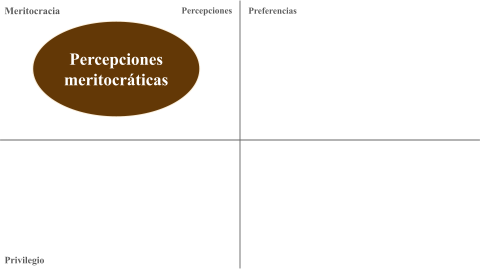

##

### Marco multidimensional de meritocracia

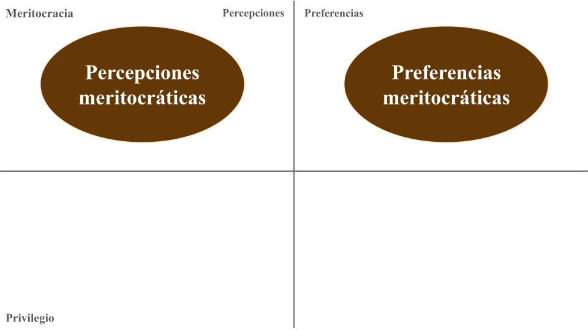

##

### Marco multidimensional de meritocracia

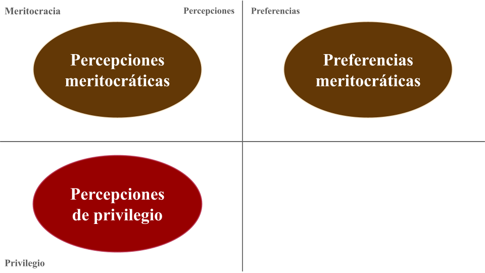

##

### Marco multidimensional de meritocracia

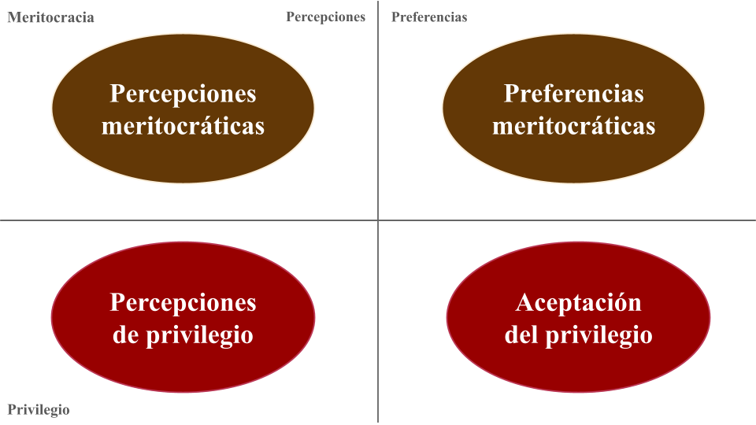

:::{.notes}
Las investigaciones han llegado hasta este punto, la relación entre merito y justicia de mercado, por un lado, y el discernimiento de un marco multidimensional por el otro. 

Ahora, como bien se ha dicho, este es un marco conceptual, por lo que son las creencias que pueden tener las personas, pero lo que no sabemos es en qué medida varían estas creencias en la población, ni en qué medida prevalecen en cuanto a tamaño y cantidad

Esta investigación pretende avanzar por este lado
:::

## 

### Sistemas de creencias meritocráticas

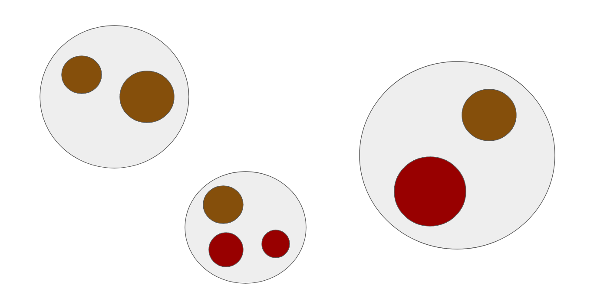

:::{.incremental style="font-size: 80%"}
- Utilizaremos **Análisis de Perfiles Latentes**, un método que permite observar la **heterogeneidad de creencias** en la población mediante la clasificación de subgrupos [@jason_handbook_2015]
:::

:::{.notes}
- Las creencias pueden parecer contradictorias, pero pueden **coexistir** dentro de los sistemas de creencias de las personas

- Sin embargo, a primera vista no es posible determinar en qué medida **varían** las creencias meritocráticas de las personas, y cómo representan a la sociedad en términos de **cantidad y tamaño** [@zhu_meritocratic_2025]

- Para ello, recurriremos a **Análisis de Perfiles Latentes (Latent Profile Analysis)**, un método que permite observar la **heterogeneidad de creencias** en la población mediante la clasificación de subgrupos
:::

# Preguntas de investigación {background-color="#303029"}


## {background-color="#303029"}

::: {.box-inv-5 .fragment .sp-after style="font-size: 130%;"}
¿Cómo se manifiestan los patrones de creencias meritocráticas en cuanto al número de grupos identificables y su tamaño?
:::

<br>

<br>

::: {.box-inv-5 .fragment .sp-after style="font-size: 130%;"}
¿En qué medida influyen los patrones de creencias meritocráticas en las preferencias por la justicia de mercado en educación?
:::

## Esta investigación

:::{.incremental .highlight-last style="font-size: 100%"}
- Contribuir en la línea de investigación sobre justicia de mercado y meritocracia [@castillo_perceptions_2025; @castillo_justification_2026; @lindh_public_2015] a partir de dos innovaciones:

  - Explorar patrones de creencias meritocráticas en la población chilena mediante un análisis integral, utilizando **métodos centrados en variables y en personas**

  - Analizar la relación entre preferencias por justicia de mercado en educación y los distintos grupos de personas definidos por sus patrones de creencias

- Así, esta investigación: 

  - A partir de las diferentes relaciones entre los perfiles y la preferencia por justicia de mercado en educación, pretende demostrar que la **meritocracia opera de manera distinta** como mecanismo para la justificación de las desigualdades, y estas diferencias son notables sólo al observar la **heterogeneidad de creencias** de las personas
:::

##

### Hipótesis

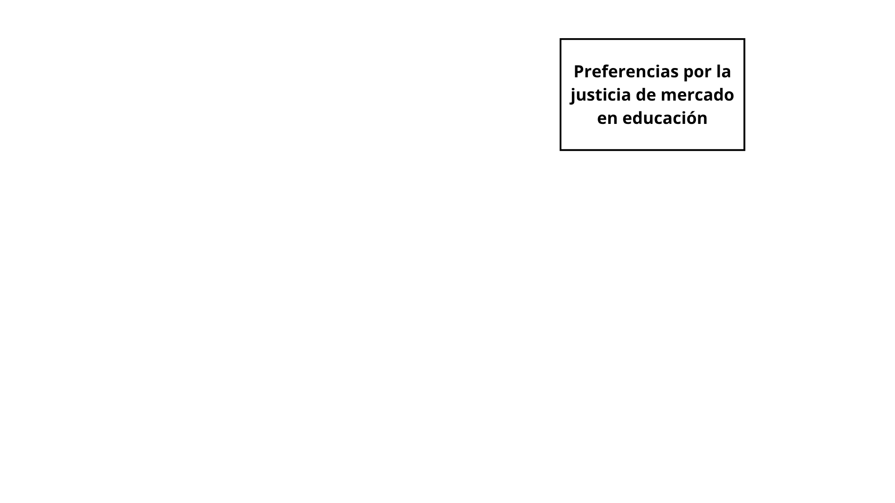

##

### Hipótesis

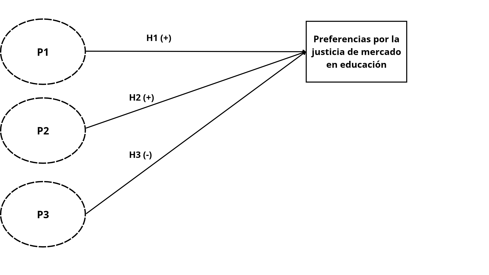

##

### Hipótesis

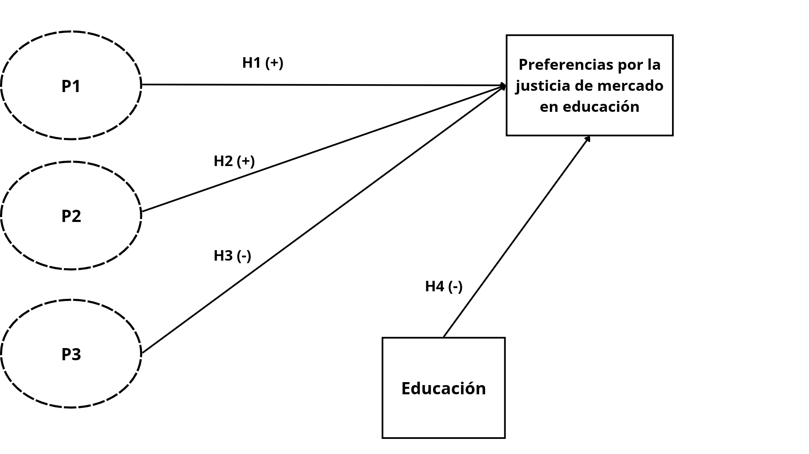

##

### Hipótesis

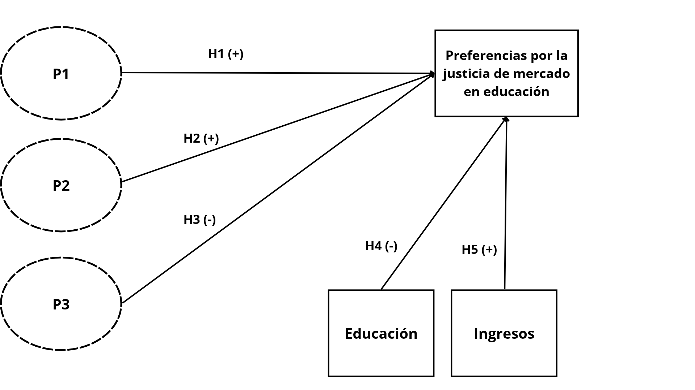

##

### Hipótesis

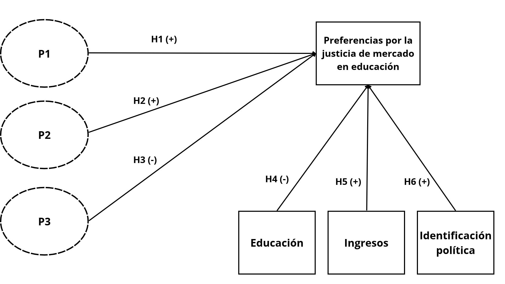


# Métodos {background-color="#303029"}

## Datos

:::{.incremental .highlight-last style="font-size: 140%"}
- Encuesta *Educación, Meritocracia y Cohesión Social* realizada por el FONDECYT N°1210847 en el año 2025

- Muestra analítica = 2489

- Aplicada mediante CAWI (Computer-Assisted Web Interviewing)

- Diseño muestral no probabilístico; cuotas de edad, sexo y nivel educacional
:::

## Variable dependiente

:::{.incremental .highlight-last style="font-size: 130%"}
- Preferencias por la justicia de mercado en educación: **_¿Es justo que las personas de altos ingresos tengan una mejor educación para sus hijos que las personas con ingresos más bajos?_**

<br>

- Escala likert: Muy en desacuerdo (1) a Muy de acuerdo (5)
:::

## Estrategia analítica

### 3 pasos

:::{.incremental .highlight-last style="font-size: 120%"}
- Modelo de ecuaciones estructurales para observar la distinción entre las dimensiones de mérito y privilegio

- Análisis de perfiles latentes para identificar patrones de creencias meritocráticas, y luego asignar a cada individuo a un grupo (perfil latente) [@jason_handbook_2015; @zhu_meritocratic_2025]

- Luego, los grupos observados son considerados como **variables independientes** en un modelo de regresión logística ordinal, con el objetivo de **examinar** la relación entre cada grupo con la preferencia por justicia de mercado en educación
:::

## Ecuaciones estructurales

:::{.incremental .highlight-last style="font-size: 120%"}
- Permite estudiar la relación entre variables observadas y no observadas (latentes)

- Se pueden combinar análisis factoriales con regresiones, y así contrastar modelos teóricos con datos empíricos

- Se utilizará para tener una primera aproximación sobre la relación entre las creencias meritocráticas y la justicia de mercado en educación 
:::

## Análisis de perfiles latentes

:::{.incremental .highlight-last style="font-size: 110%"}
- Modelo que agrupa a las personas según sus **patrones de respuesta** en indicadores que se asumen continuos

- Trabaja bajo el supuesto que existen **subpoblaciones no observadas** (perfiles), cada una con medias propias en los indicadores; a cada persona se le asigna el perfil con mayor **probabilidad posterior**

- El número de perfiles se elige comparando modelos con 1 a *k* perfiles, según:
  - **AIC y BIC**: menores valores indican mejor ajuste
  - **Entropía**: valores cercanos a 1 indican perfiles bien separados
  - **BLRT**: contrasta si agregar un perfil mejora significativamente el ajuste
  - Tamaño de los perfiles e **interpretabilidad** sustantiva
:::

##

$$
f(\mathbf{y}_i) = \sum_{k=1}^{K} \pi_k \prod_{j=1}^{8} f_k(y_{ij}), \qquad
y_{ij} \mid k \sim N(\mu_{jk}, \sigma_j^2)
$$

Donde:

$\pi_k$: probabilidad de pertenecer al perfil $k$ ($\sum_k \pi_k = 1$)

$\mu_{jk}$: media del ítem $j$ en el perfil $k$;

$y_{ij}$: respuesta ordinal (1-4) de la persona $i$ al ítem $j$, tratada como continua. Varianzas iguales entre perfiles e independencia condicional al perfil

## Regresión logística ordinal

Modelo de odds proporcionales, donde $Y_i$ es la justicia de mercado en educación (4 categorías ordenadas):

$$
\text{logit}\, P(Y_i \leq c) = \ln \frac{P(Y_i \leq c)}{P(Y_i > c)} = \tau_c - \left( \sum_{k=2}^{K} \beta_k \, \text{Perfil}_{ik} + \boldsymbol{\gamma}' \mathbf{x}_i \right), \qquad c = 1, 2, 3
$$

Donde:

$\tau_c$: umbrales (*thresholds*) entre categorías, con $\tau_1 < \tau_2 < \tau_3$

$\text{Perfil}_{ik}$: variable *dummy* de pertenencia de la persona $i$ al perfil $k$ (perfil de referencia: $k = 1$)

$\mathbf{x}_i$: independientes (sexo, educación, ingreso, identificación política)

$\exp(\beta_k)$: *odds ratio* de estar en una categoría más alta de justicia de mercado, respecto al perfil de referencia

# Resultados {background-color="#303029"}

## 

::: {.v-center-container}
```{r}
#| fig-cap: "Distribución de respuestas. Fuente: EDUMERCO (2025)"
#| out-width: "100%"

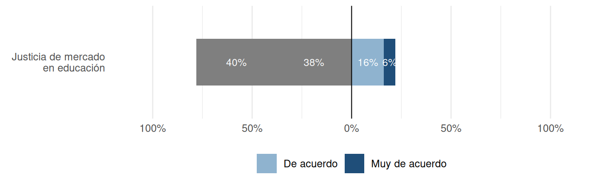
```
:::

## 

```{r}
#| fig-cap: "Distribución de respuestas. Fuente: EDUMERCO (2025)"

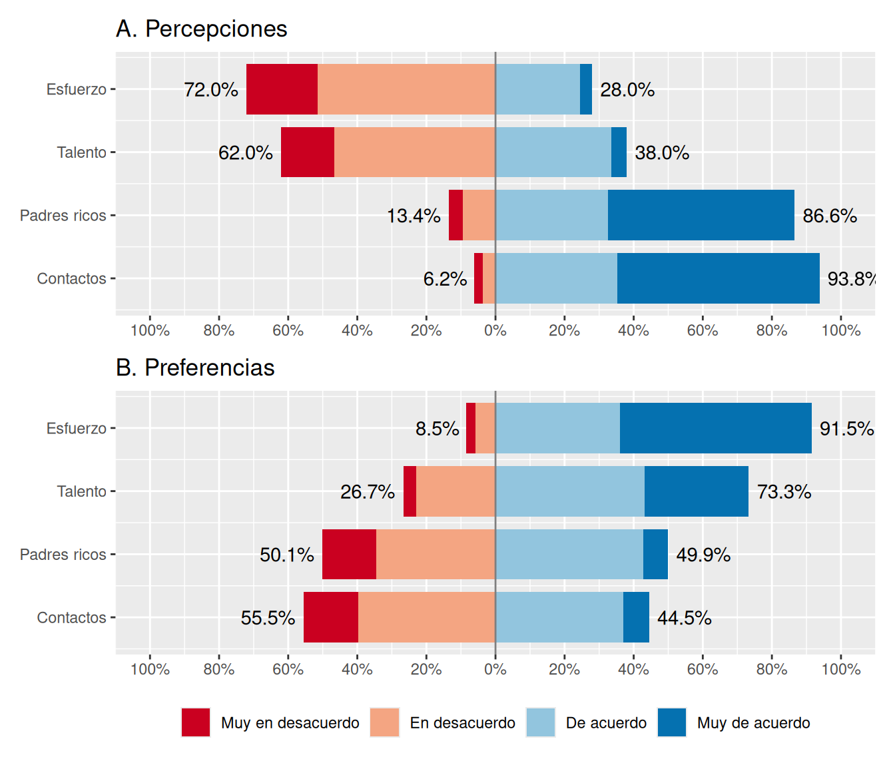
```

## 

```{r}
#| fig-cap: "Matriz de correlaciones. Fuente: EDUMERCO (2025)"

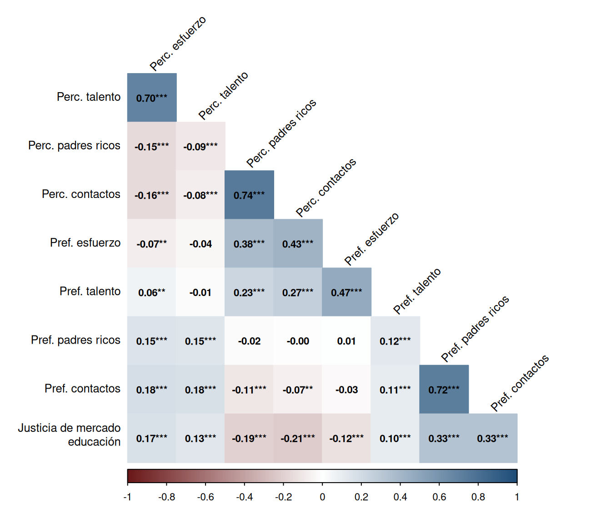
```

## 

```{r}
#| fig-cap: "Modelo de ecuaciones estructurales. Fuente: EDUMERCO (2025)"
#| out-width: "150%"

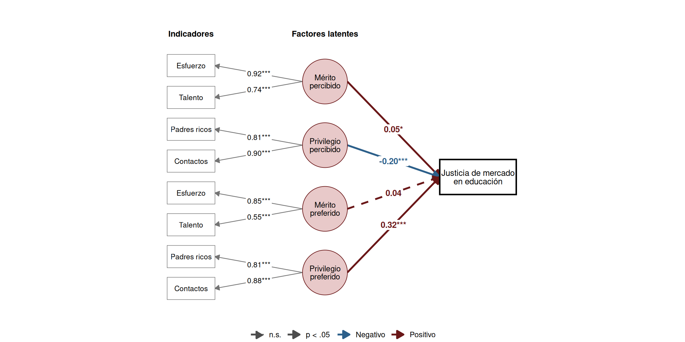
```

## 

```{r}
#| fig-cap: "Análisis de perfiles latentes. Fuente: EDUMERCO (2025)"
#| out-width: "100%"

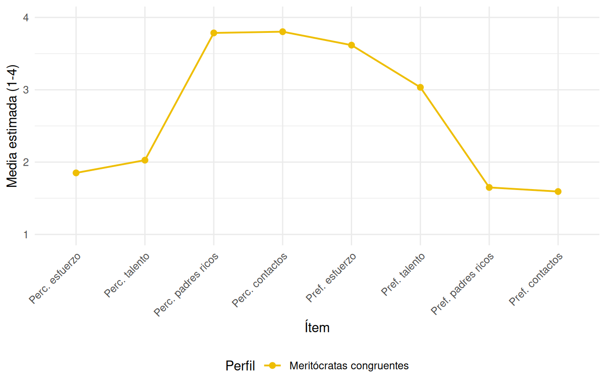
```

## 

```{r}
#| fig-cap: "Análisis de perfiles latentes. Fuente: EDUMERCO (2025)"
#| out-width: "100%"

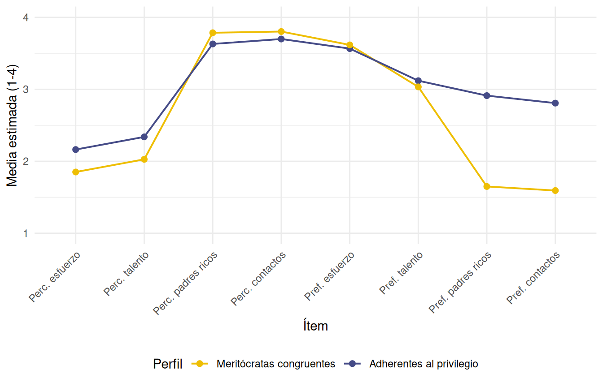
```

## 

```{r}
#| fig-cap: "Análisis de perfiles latentes. Fuente: EDUMERCO (2025)"
#| out-width: "100%"

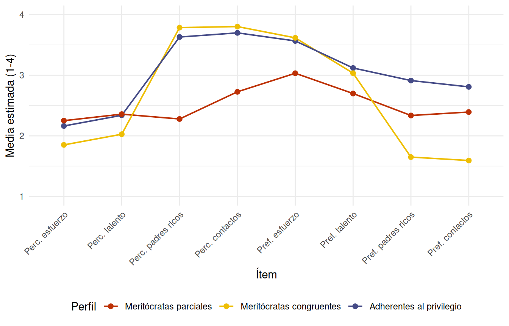
```

## 

```{r}
#| fig-cap: "Tamaño de perfiles latentes. Fuente: EDUMERCO (2025)"
#| out-width: "100%"

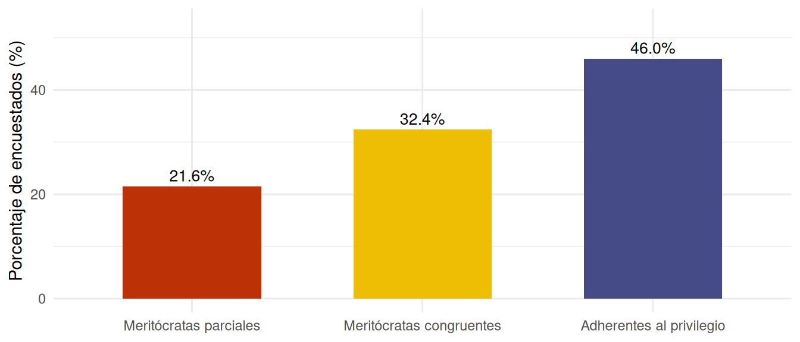
```


## 

```{r}
#| fig-cap: "Bivariados con perfiles latentes. Fuente: EDUMERCO (2025)"
#| out-width: "100%"

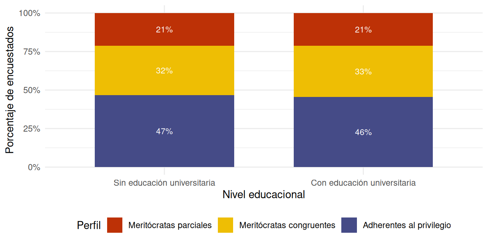
```

## 

```{r}
#| fig-cap: "Bivariados con perfiles latentes. Fuente: EDUMERCO (2025)"
#| out-width: "100%"

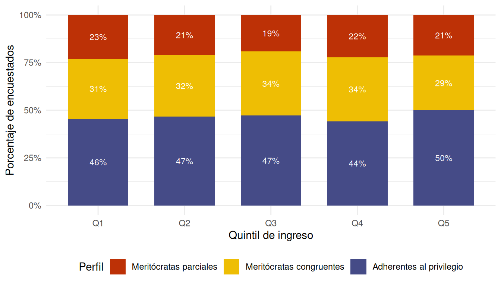
```

##

```{r}
#| fig-cap: "Bivariados con perfiles latentes. Fuente: EDUMERCO (2025)"
#| out-width: "100%"

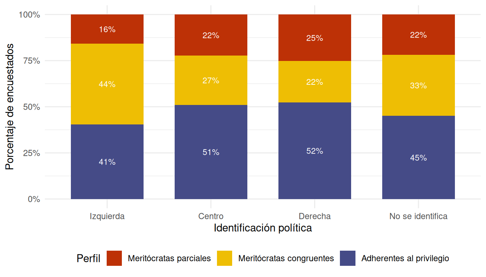
```


##  

```{r}
#| fig-cap: "Coef plot en base a resultados. Fuente: EDUMERCO (2025)"
#| out-width: "82%"

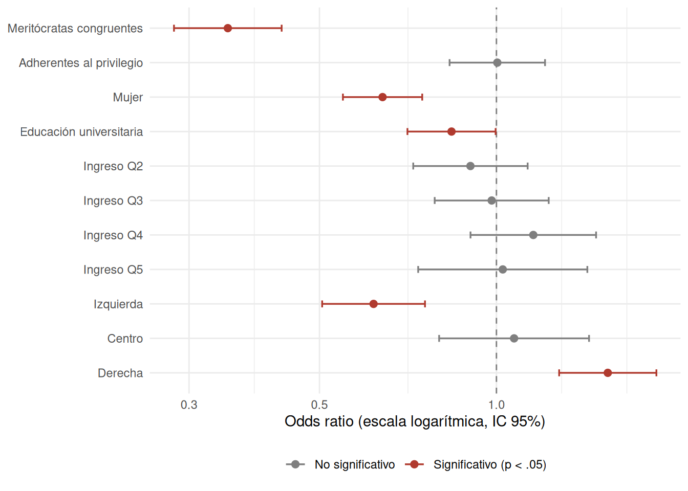
```

## 

```{r}
#| fig-cap: "Coef plot en base a resultados. Fuente: EDUMERCO (2025)"
#| out-width: "75%"

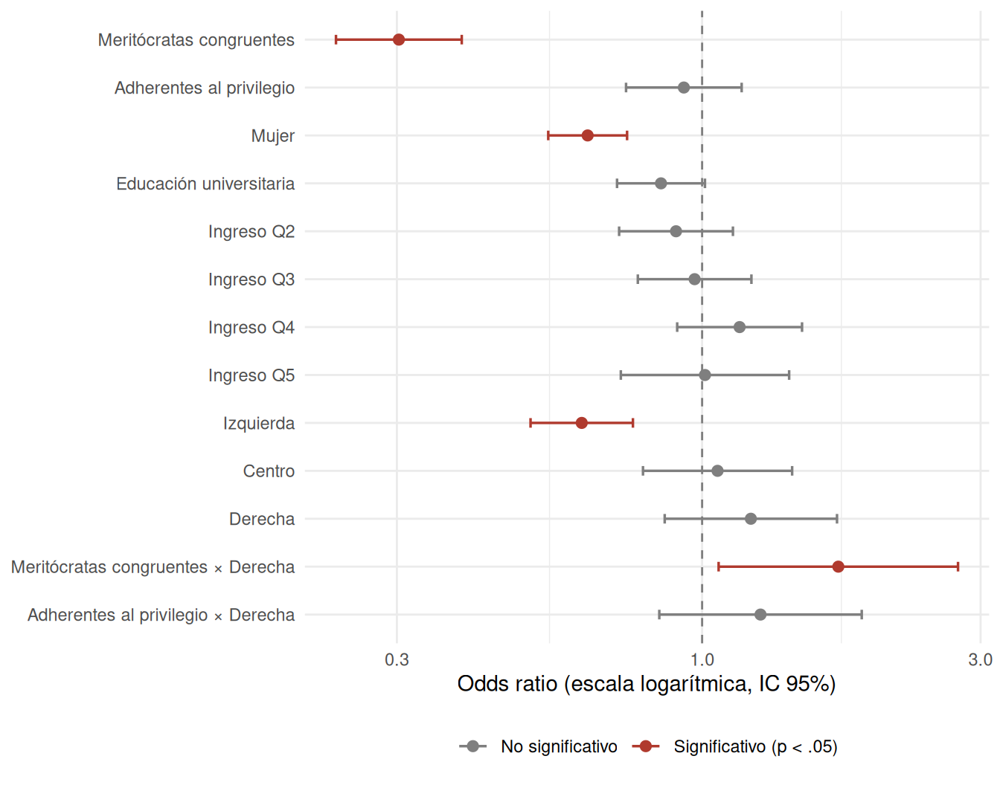
```

# Discusión {background-color="#302929"}

##

:::{.incremental .highlight-last style="font-size: 140%"}
- Inicialmente, es posible identificar una estructura subyacente que distinga **cómo se relacionan las creencias** meritocráticas y de privilegio **con la justicia de mercado en educación** (Modelo SEM)

<br>

- Además, mediante el Análisis de Perfiles Latentes, existe evidencia a favor sobre cómo **estas creencias se organizan mediante distintas configuraciones** dentro de la mente de las personas
:::

## 

:::{.incremental .highlight-last style="font-size: 120%"}
- Se encontró un perfil con tendencias meritocráticas pero no se cumplió la relación esperada con la variable dependiente **($H_{1}$)**

<br>

- Se encontró un perfil que da cuenta de la existencia de privilegios pero no se cumplió la relación esperada con la variable dependiente **($H_{2}$)**

<br>

- No se encontró un perfil de conciencia dual, por lo que tampoco se cumplió la relación esperada con la variable dependiente **($H_{3}$)**
:::

##

:::{.incremental .highlight-last style="font-size: 120%"}
- Los individuos con mayor nivel educacional presentan un menor apoyo a la justicia de mercado en educación **($H_{4}$)** [@busemeyer_inequality_2012; @liu_does_2026]

<br>

- El ingreso no tiene un efecto significativo en la justicia de mercado en educación **($H_{5}$)**

<br>

- Las personas que se identifican con derecha sostienen una mayor adherencia a la justicia de mercado en educación que aquellas de izquierda **($H_{6}$)** [@lee_fairness_2024; @castillo_changes_2025]
:::

##

:::{.incremental .highlight-last style="font-size: 130%"}
- La interacción entre el perfil *Meritócratas congruentes* y el espectro de derecha puede explicarse mediante la reconfiguración cultural e identitaria de este sector [@hausermann_realignment_2026]:

  - La derecha tradicional podía encontrar un discurso coherente dentro de un esquema definido (apoyo al mercado, alto estatus socioeconómico)

  - Actualmente, el perfil de quienes simpatizan con la derecha se ha diversificado en gran medida, en donde la legitimación de estos programas políticos puede convivir con condiciones supuestamente contrarias
:::


# Pasos finales {background-color="#303029"}

##

:::{.incremental .highlight-last style="font-size: 140%"}
- Robustecer la discusión de resultados

<br>

- Plantear las limitaciones y próximas ideas a estudiar a partir de esta investigación

<br>

- Terminar la tesis
:::


## Referencias

::: {#refs}
:::

# Anexos {background-color="#303029"}

## Items del marco multidimensional

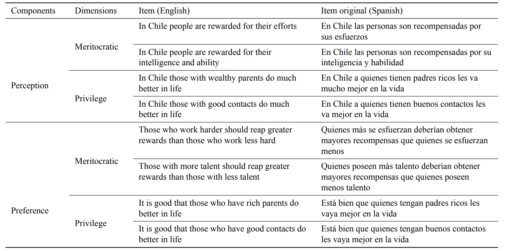

## Estimación de Clases Latentes

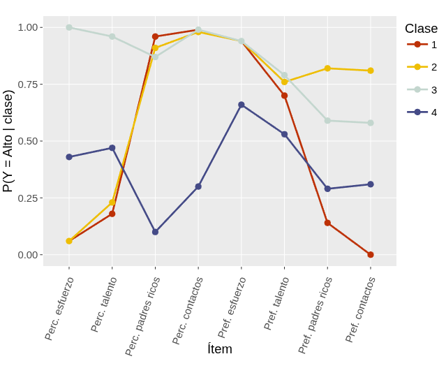{width="70%"}


## Fit de los Perfiles Latentes

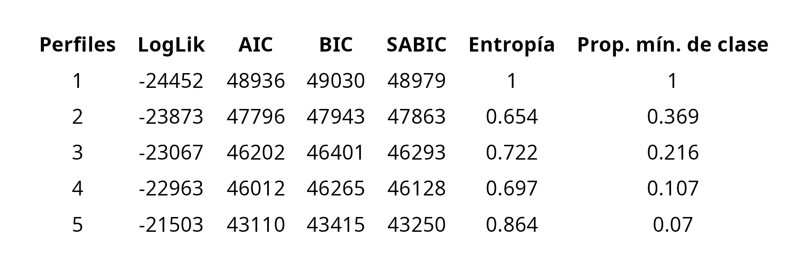

## Modelos de regresión completos {.scrollable}

```{r}
#| echo: false

readRDS("tbl-polr-lpa.rds") |>
  tinytable::style_tt(fontsize = 0.5)
```